# Evaluación Parcial N°2 – Implementación de bases de datos NoSQL y manipulación de datos

**Asignatura:** BDY0101 Base de Datos No Relacionales · **Caso:** Forma B – QuickTrack  
**Integrantes:** Alvaro Uribe · Nicolas Mansilla · Genesis Montero  
**Docente:** German Barrientos · **Sección:** BDY0101-001D  
**Repositorio:** https://github.com/Unknumb/quicktrack-nosql-ev2

---

## 1. Objetivos del proyecto

**Objetivo general.** Implementar una base de datos documental en MongoDB Atlas para QuickTrack, empresa de entregas express, e integrarla con una API REST. El sistema debe registrar órdenes, el seguimiento de los paquetes y las valoraciones de los clientes, y entregar indicadores que ayuden a optimizar rutas, detectar zonas críticas y medir la satisfacción.

**Objetivos específicos**

1. Configurar un clúster NoSQL en MongoDB Atlas con validación de esquema, índices y credenciales de acceso (IL2.1).
2. Cargar y normalizar los datos del anexo (clientes, rutas, órdenes, seguimiento y valoraciones) y verificar la carga (IL2.1).
3. Construir consultas y agregaciones que respondan requerimientos de negocio, y medir su eficiencia (IL2.2).
4. Implementar un flujo CRUD completo con transacciones, validaciones y corrección de inconsistencias (IL2.3).
5. Exponer la base de datos mediante una API REST (Flask + PyMongo) con trazabilidad y control de errores (IL2.4).

---

## 2. Configuración de la base de datos NoSQL

### 2.1 Tecnología y API seleccionada

| Opción | ¿Sirve para QuickTrack? |
|---|---|
| **Documental (MongoDB / Core SQL / API for MongoDB)** ✅ | Una orden, su historial de seguimiento y su valoración son documentos JSON con arreglos anidados (`historial`). Se necesitan filtros, proyecciones, ordenamientos y agregaciones (`$group`, `$lookup`) para los KPI. |
| Gremlin (grafos) | Sirve para recorrer relaciones (por ejemplo, la ruta más corta). El caso no pide recorridos de grafo, sino análisis por zona, estado y puntaje. |
| Table API (clave-valor) | No admite documentos anidados ni agregaciones; cada KPI habría que calcularlo en la aplicación. |

Se eligió **MongoDB Atlas (modelo documental)** por cuatro razones: el enunciado lo recomienda, tiene un nivel gratuito (M0), acepta conexión externa por URI y se integra directamente con Python (`pymongo`), Compass y Power BI. Atlas es equivalente a Azure Cosmos DB con API para MongoDB: los mismos scripts funcionan cambiando solo la cadena de conexión.

### 2.2 Parámetros configurados

| Parámetro | Valor | Justificación |
|---|---|---|
| Proveedor / tier | MongoDB Atlas M0 (gratuito), MongoDB 8.0, región AWS São Paulo (sa-east-1) | Nivel suficiente para 500 documentos de prueba |
| Clúster | `Cluster0`, *replica set* de 3 nodos | Alta disponibilidad; permite transacciones multi-documento |
| Base de datos | `QuickTrack` | — |
| Colecciones (≈ contenedores) | `clientes`, `rutas`, `ordenes_entrega`, `seguimiento`, `valoraciones`, `contadores` | Una por entidad del caso y una para secuencias de ID |
| Credenciales | Usuario `quicktrack_app`, autenticación SCRAM, rol *readWriteAnyDatabase* | Puede leer y escribir datos, pero no administrar el clúster. La contraseña va en `.env`, que no se sube al repositorio. En producción se limitaría a `readWrite` sobre `QuickTrack`. |
| Network Access | Lista de IPs autorizadas (/32) | Solo los equipos autorizados pueden conectarse |
| Clave de partición (*shard key*) propuesta | `ordenes_entrega`: `{cliente_id: "hashed"}` | Alta cardinalidad y distribución uniforme. `zona` se descartó porque tiene solo 5 valores y concentraría la carga en una partición. M0 no permite sharding, así que la clave queda documentada para escalar a M30 o más. En Cosmos DB sería `/cliente_id`. |
| Throughput | M0 compartido (≈100 ops/s, 512 MB) | Suficiente para el volumen de prueba. En Cosmos DB el equivalente sería 400 RU/s manual o *autoscale*. |
| Consistencia | `writeConcern: majority`, `retryWrites: true` y transacciones con *snapshot* | Una escritura confirmada no se pierde si cae un nodo. Equivale a *Session/Strong* en Cosmos DB. |
| Validación | `$jsonSchema` estricto (`validationAction: error`) en todas las colecciones | La base rechaza documentos mal formados aunque la aplicación falle |

**Índices creados**

| Colección | Índice | Uso |
|---|---|---|
| clientes | `ux_correo` (único) | Evita clientes duplicados |
| rutas | `ix_zona_distancia {zona:1, distancia_km:-1}` | Rutas más largas por zona |
| ordenes_entrega | `ix_zona_estado_total {zona:1, estado:1, total:-1}` | Consultas por zona y estado ordenadas por valor (regla ESR: igualdad, orden, rango) |
| ordenes_entrega | `ix_cliente`, `ix_fecha_envio` | Historial por cliente y consultas por rango de fechas |
| seguimiento / valoraciones | `ux_orden` (único) | Un seguimiento y una valoración por orden; acelera los `$lookup` |
| valoraciones | `ix_puntaje` | Búsqueda de valoraciones críticas |

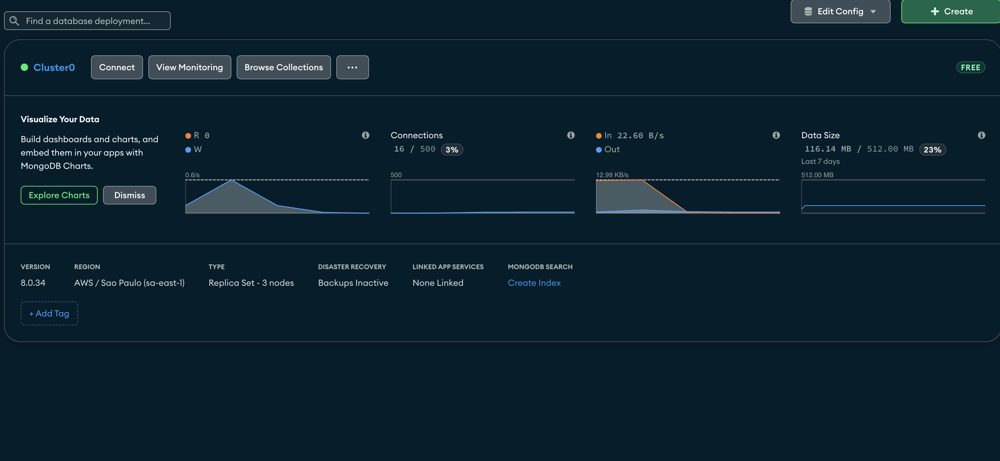
*Figura 1. Clúster `Cluster0` en Atlas: M0 FREE, MongoDB 8.0.34, AWS São Paulo, replica set de 3 nodos.*

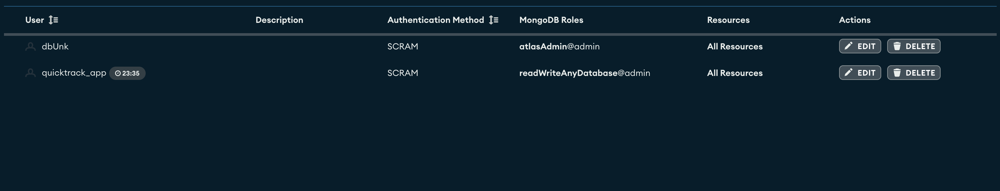
*Figura 2. Database Access: usuario `quicktrack_app` con autenticación SCRAM.*

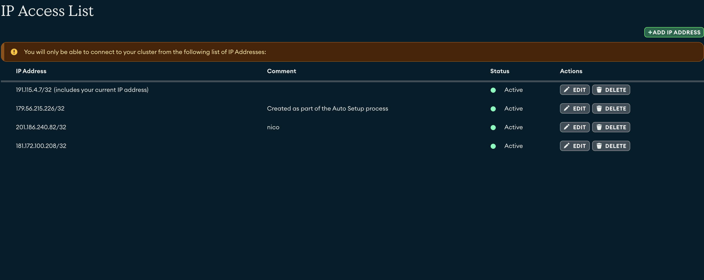
*Figura 3. Network Access: lista de IPs autorizadas para conectarse al clúster.*

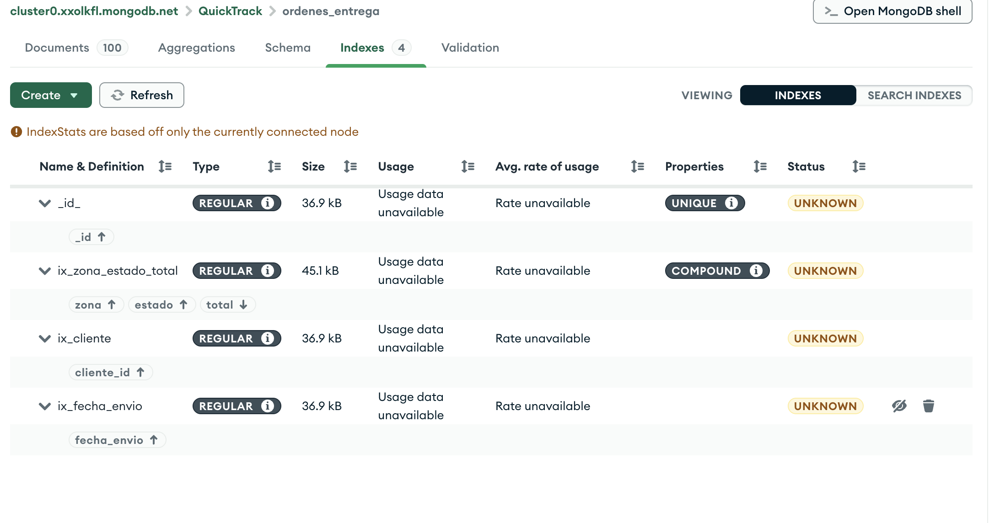
*Figura 4. Compass: índices de `ordenes_entrega`, incluido el compuesto `ix_zona_estado_total`.*

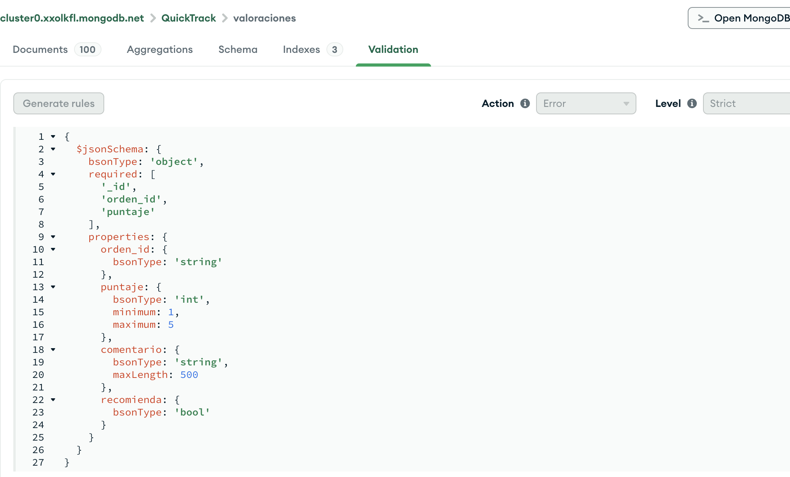
*Figura 5. Compass: validación `$jsonSchema` de `valoraciones` (Action: Error, Level: Strict).*

### 2.3 Problemas encontrados y cómo se resolvieron

| Problema | Solución |
|---|---|
| Timeout al conectar desde Python | Se agregó la IP del equipo en *Network Access*; `serverSelectionTimeoutMS=8000` entrega un mensaje claro |
| `clientes.json` es un arreglo JSON y el resto son JSON Lines | La función `leer_json()` detecta y acepta ambos formatos |
| `clientes._id` es entero (`1`), pero `ordenes.cliente_id` es texto (`"cli_1"`); el 100 % de las órdenes quedaban sin cliente | Se normalizó `_id` a `"cli_N"` durante la carga |
| Fechas guardadas como texto | Se convirtieron a tipo `date`, lo que permite rangos y `$dateDiff` |
| La orden no indica su zona | Se copió `zona` desde la ruta al cargar (desnormalización), para filtrar sin `$lookup` |
| La API respondía 403 en `localhost:5000` | En macOS ese puerto lo ocupa AirPlay; la API se movió al puerto 5050 |

---

## 3. Inserción de datos de prueba

El script `01_setup_y_carga.py` hace lo siguiente:
1. Elimina y recrea las colecciones con su `$jsonSchema` (el script es idempotente).
2. Crea los índices.
3. Transforma los datos según la tabla 2.3.
4. Inserta con `insert_many(ordered=False)`.
5. Compara la cantidad de documentos de cada archivo con la cantidad en la base.

```python
db.create_collection("valoraciones", validator={"$jsonSchema": {
    "bsonType": "object", "required": ["_id", "orden_id", "puntaje"],
    "properties": {"puntaje": {"bsonType": "int", "minimum": 1, "maximum": 5}, ...}}},
    validationLevel="strict", validationAction="error")
db.valoraciones.create_index([("orden_id", 1)], unique=True, name="ux_orden")
res = db.valoraciones.insert_many(lista, ordered=False)
```

**Resultado de la verificación:** las cinco colecciones quedaron con 100/100 documentos, sin rechazos del validador.

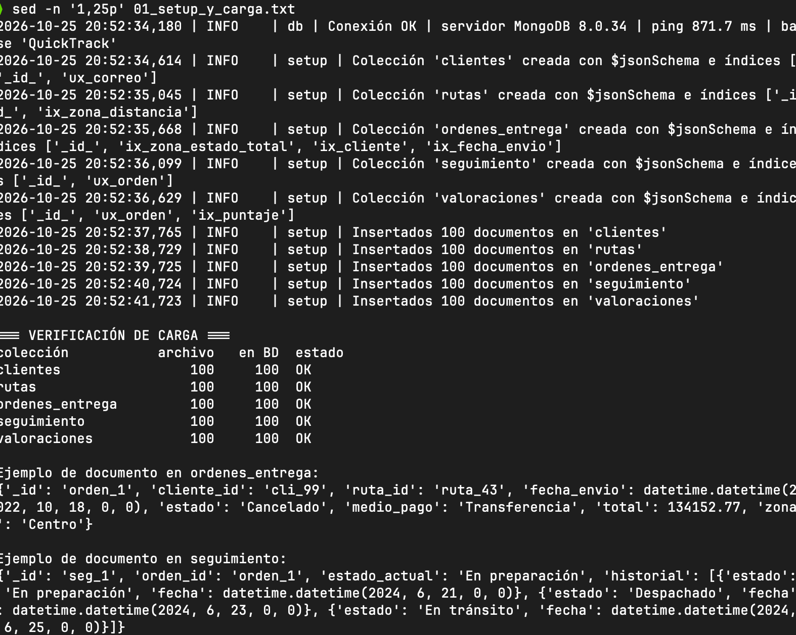
*Figura 6. Salida de `01_setup_y_carga.py`: colecciones creadas, inserción y verificación 100/100.*

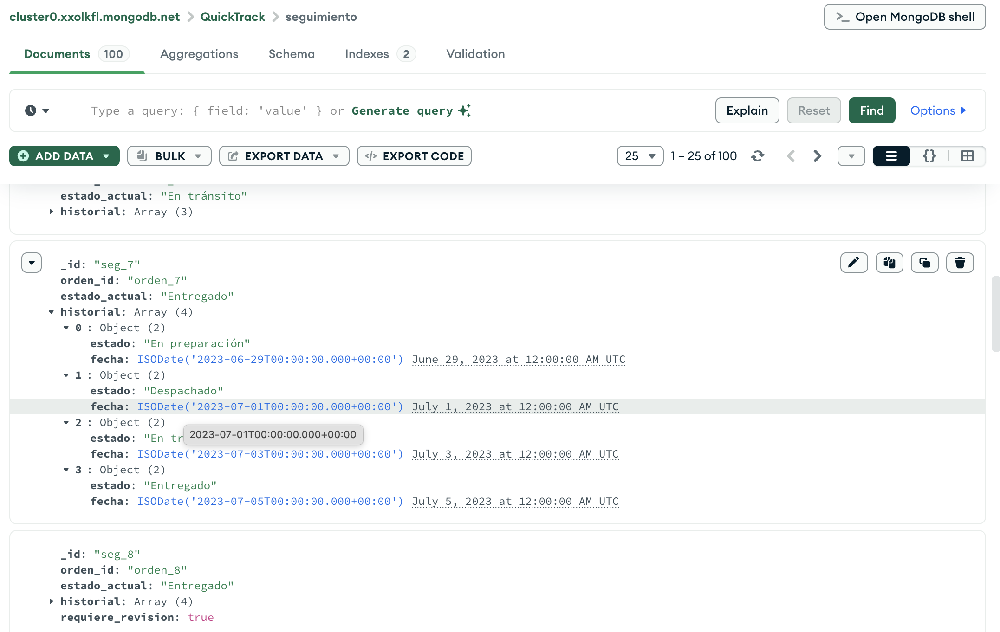
*Figura 7. Compass: documento de `seguimiento` con su arreglo `historial` y fechas de tipo `ISODate`.*

---

## 4. Desarrollo de consultas sobre la base de datos

Todas las consultas están en `02_consultas.py`. Cada resultado se exporta a `resultados/*.csv`, que puede usarse como fuente en Power BI.

| # | Requerimiento de negocio | Técnica |
|---|---|---|
| C1 | Órdenes **entregadas** de la zona **Norte** con total > $100.000, de mayor a menor | Filtro + proyección + `sort` |
| C2 | Órdenes de 2024 pagadas en efectivo que siguen pendientes | `$in` + rango de fechas `$gte/$lt` (búsqueda compuesta) |
| C3 | Valoraciones críticas (puntaje ≤ 2 **o** comentario de retraso o de producto dañado) | `$or` + `$lte` + `$in` |
| C4 | Las 3 rutas más largas de cada zona | `$sort` + `$group` + `$push` + `$slice` |
| C5 | KPI por zona: órdenes, % canceladas, % retraso, puntaje promedio | `$lookup` + `$group` + `$cond` |
| C6 | % de clientes que recomiendan según medio de pago | `$lookup` + `$group` |
| C7 | Días promedio de entrega por zona | `$filter` + `$dateDiff` + `$lookup` |
| C8 | Top 5 clientes por monto enviado | `$match` + `$group` + `$limit` + `$lookup` |

Ejemplo (C1):
```python
db.ordenes_entrega.find(
    {"zona": "Norte", "estado": "Entregado", "total": {"$gt": 100000}},
    {"_id": 1, "cliente_id": 1, "fecha_envio": 1, "total": 1}
).sort("total", -1)
```

**Resultados de C5 – Zonas críticas (datos del anexo)**

| Zona | Órdenes | % canceladas | % con retraso | Puntaje prom. |
|---|---|---|---|---|
| Centro | 17 | **47,1** | 17,6 | **2,71** |
| Sur | 13 | 23,1 | 15,4 | 3,00 |
| Norte | 22 | 36,4 | 13,6 | 3,00 |
| Poniente | 22 | 9,1 | 4,5 | 3,14 |
| Oriente | 26 | 7,7 | **19,2** | 3,35 |

**Conclusiones para el negocio**
- **Centro** es la zona más crítica: casi la mitad de sus órdenes se cancelan y tiene el puntaje más bajo.
- **Oriente** tiene el mayor % de comentarios de retraso, aunque su satisfacción general es la más alta.
- Por medio de pago (C6), **Transferencia** tiene el mayor % de clientes que recomiendan (50 %) y **Efectivo** el menor (38,2 %).
- C7 muestra un tiempo de entrega constante de 6 días en todas las zonas, lo que indica que los datos de prueba son sintéticos (intervalos fijos de 2 días entre eventos). Con datos reales, este KPI permitiría comparar el cumplimiento de plazos entre zonas.

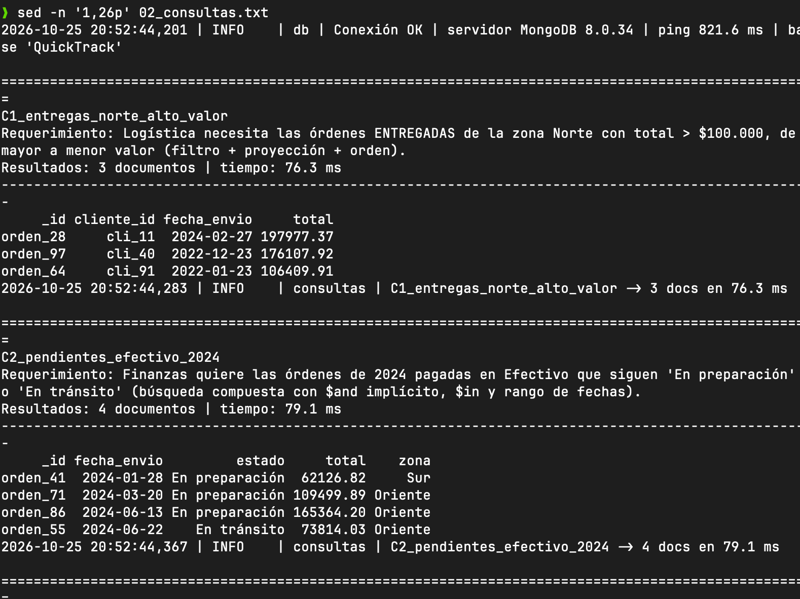
*Figura 8. Consultas C1 (filtro, proyección y orden) y C2 (búsqueda compuesta con `$in` y rango de fechas).*

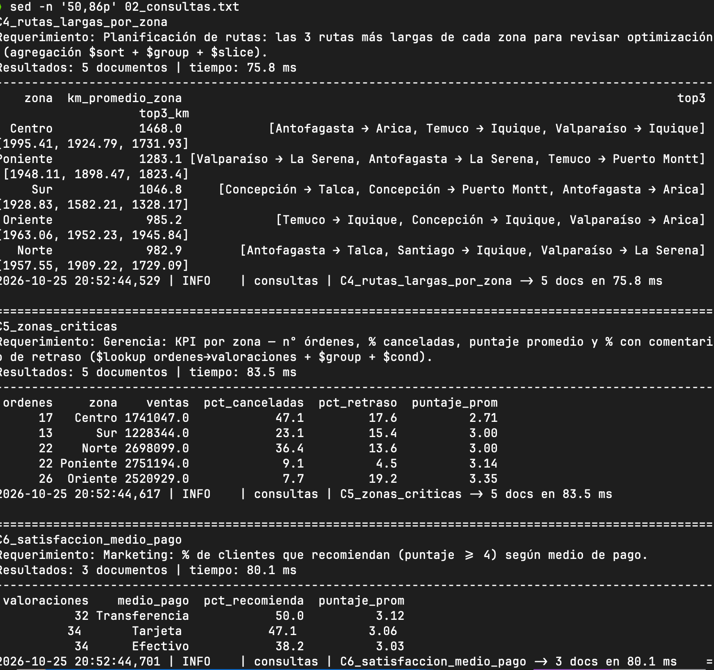
*Figura 9. Agregaciones C4 (rutas más largas), C5 (zonas críticas) y C6 (satisfacción por medio de pago).*

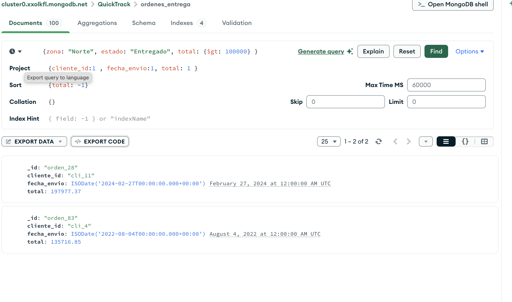
*Figura 10. Consulta C1 en Compass con Filter, Project y Sort.*

### 4.1 Eficiencia de las consultas (`04_rendimiento.py`)

El script usa `explain("executionStats")` para comparar cada consulta con índice y forzando un recorrido completo (`hint({$natural:1})`). También mide los KB transferidos con y sin proyección y hace una prueba de volumen con 20.000 órdenes sintéticas.

Prueba de volumen con 20.000 documentos, ejecutada en MongoDB Atlas M0 (MongoDB 8.0):

| Caso | Plan | Docs examinados | Devueltos | ms servidor | ms cliente | KB transferidos |
|---|---|---|---|---|---|---|
| Sin índice | COLLSCAN + SORT | 20.000 | 43 | 61 | 106,65 | 1,52 |
| Con índice compuesto | IXSCAN | 43 | 43 | 1 | 85,06 | 1,52 |
| Índice sin proyección | IXSCAN | 43 | 43 | 0 | 89,74 | 6,15 |

**Análisis y mejoras propuestas**
1. El índice compuesto `{zona, estado, total}` reduce los documentos examinados en un **99,8 %** (de 20.000 a 43) y el tiempo en el servidor de 61 ms a 1 ms. También elimina la etapa `SORT` en memoria, porque el índice ya entrega los datos ordenados.
2. Unos 80 ms del tiempo medido en el cliente corresponden a la latencia de red hasta el clúster de Atlas. Por eso el tiempo del servidor (`executionTimeMillis`) es la métrica más fiable para evaluar la consulta en sí, y conviene reducir la cantidad de viajes a la base: traer lo necesario en una sola consulta o agregación en lugar de hacer varias.
3. Con 100 documentos la diferencia no se nota; el beneficio crece con el volumen. Por eso los índices se definen desde el diseño.
4. La **proyección** reduce los datos transferidos a cerca de un 25 % (de 6,15 KB a 1,52 KB). Esto importa en la red hacia Atlas y en la API, por eso `/ordenes` siempre proyecta.
5. Mejoras futuras:
   - Paginar por rango (`_id > último`) en lugar de `skip` cuando haya miles de páginas.
   - Mantener un campo precalculado `dias_entrega` al marcar una orden como *Entregado*, para no calcular `$dateDiff` en cada consulta.
   - Crear una vista materializada (`$merge`) para los KPI diarios que consuma Power BI.

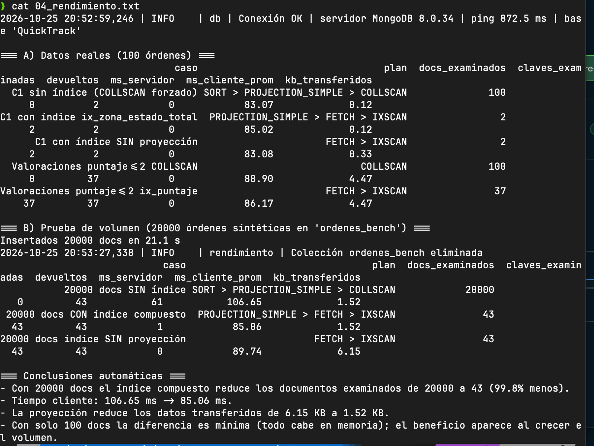
*Figura 11. Salida de `04_rendimiento.py`: COLLSCAN vs. IXSCAN, prueba de volumen y conclusiones.*

---

## 5. Operaciones CRUD completas

`03_crud.py` simula el ciclo de vida completo de un envío. Usa las mismas funciones de `servicio.py` que la API.

| Paso | Operación | Detalle |
|---|---|---|
| 1 | **Create** | Crea un cliente (correo único). Luego crea la orden y su seguimiento **en una sola transacción**: si falla una inserción, no se guarda ninguna. Antes valida que el cliente y la ruta existan, porque MongoDB no tiene claves foráneas. |
| 2 | **Read** | Consulta la orden completa con `$lookup` a cliente, ruta, seguimiento y valoración |
| 3 | **Update** | Avanza el estado: *En preparación → Despachado → En tránsito → Entregado*. Cada cambio es una transacción con `$set` en la orden y `$set` + `$push` en el historial. Usa control optimista: el filtro incluye el estado leído, así no se pisa un cambio hecho por otro proceso. |
| 4 | **Create** | Registra la valoración (solo se permite si la orden fue entregada) |
| 4b | **Update masivo** | `update_many` marca `requiere_contacto: true` en las 37 valoraciones con puntaje ≤ 2 |
| 7 | **Delete** | Borrado en cascada de la orden, su seguimiento y su valoración (transacción) y luego del cliente |

**Verificación final:** los conteos iniciales y finales de cada colección coinciden (100/100/100/100), es decir, no hubo pérdida ni duplicación de datos. El script es idempotente: limpia los datos de una ejecución anterior antes de empezar.

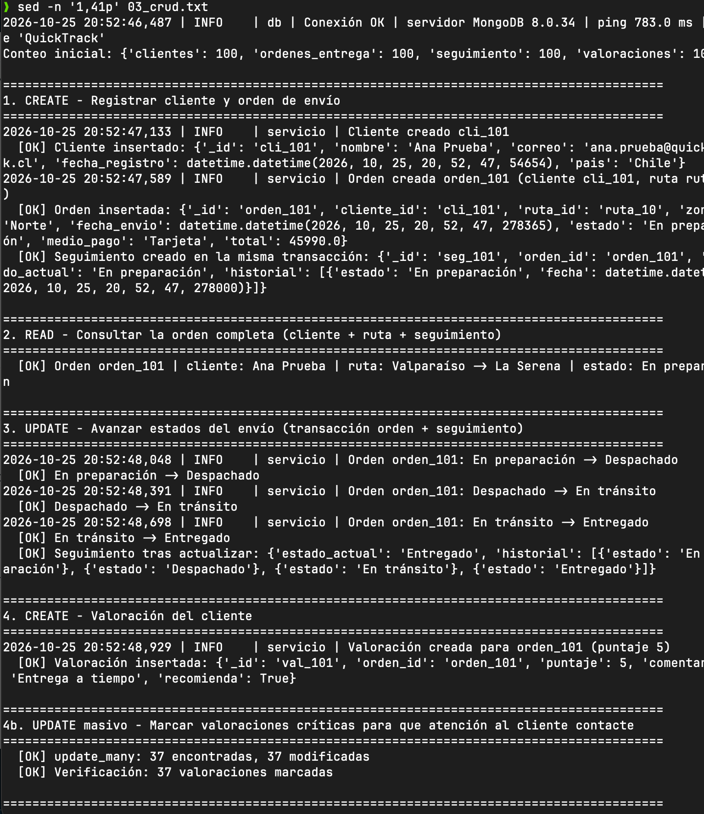
*Figura 12. Salida de `03_crud.py`: Create, Read, Update con transacción, valoración y update masivo.*

### 5.1 Validación de resultados: errores detectados y soluciones (IE8)

| Error común | Cómo se detecta | Solución aplicada |
|---|---|---|
| **Duplicación** (correo, `_id`, segunda valoración) | Índices únicos (código E11000) y verificación previa | Se rechaza con 409 Conflict |
| **Esquema inválido** (puntaje 9, estado "Perdido") | `$jsonSchema` (código 121) y validación en la aplicación | Se rechaza con 400 o un error de validación |
| **Referencias huérfanas** (cliente o ruta inexistente) | Verificación previa en `servicio.py`; agregación `$lookup` + `$size: 0` | Se rechaza con 404; la auditoría muestra 0 huérfanas |
| **Inconsistencia interna**: `estado_actual` del seguimiento distinto del último evento del historial | `$expr` + `$last` → **72 de 100** documentos | `update_many` con pipeline: `estado_actual = $last(historial.estado)`. Quedan 0. |
| **Inconsistencia entre colecciones**: estado de la orden distinto del seguimiento | Agregación con `$lookup` → **81 órdenes** | El seguimiento se toma como fuente de verdad: se sincronizan 58. Las 23 canceladas que tienen seguimiento activo se marcan `requiere_revision` para revisión manual. |
| **Pérdida de contexto** (orden sin seguimiento o seguimiento sin orden) | — | Las escrituras relacionadas se hacen en transacción y el borrado es en cascada |
| **Transición inválida** (*Entregado → En preparación*) | Máquina de estados `TRANSICIONES` | Se rechaza con 409 |

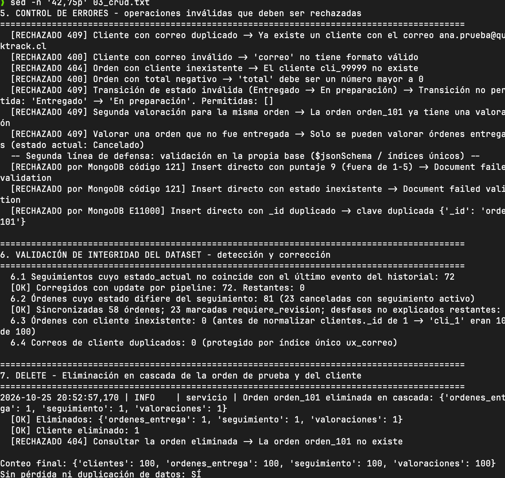
*Figura 13. Errores rechazados por la aplicación y por MongoDB, corrección de inconsistencias, Delete en cascada y conteo final sin pérdida de datos.*

---

## 6. Integración con aplicación externa

**Flujo:** Cliente (Postman, `05_prueba_api.py` o un frontend) → HTTP/JSON → **API REST Flask** (`app.py`) → reglas de `servicio.py` → **PyMongo** → TLS → **MongoDB Atlas**

| Elemento | Detalle |
|---|---|
| Herramientas | API REST con Flask 3; pruebas con Postman (colección en `postman/`) y con un script en Python (`requests`) |
| Librerías | `pymongo[srv]`, `flask`, `python-dotenv`, `pandas`, `requests` |
| Cadena de conexión | `mongodb+srv://<usuario>:<clave>@cluster0.xxxxx.mongodb.net/?retryWrites=true&w=majority`, leída desde `.env` (no se sube al repositorio) |
| Endpoints | `GET /health`, `GET /ordenes` (filtros y paginación), `GET /ordenes/{id}`, `POST /ordenes`, `PATCH /ordenes/{id}/estado`, `DELETE /ordenes/{id}`, `POST /clientes`, `POST /valoraciones`, `GET /kpis/zonas` |

**Conectividad verificada con varias herramientas (IE3):**
1. Atlas Data Explorer
2. MongoDB Compass
3. Driver Python (`pymongo`), con ping y latencia en el log
4. API REST (`/health`)
5. Postman (Runner: 20/20 tests aprobados)

**Evidencia de lectura y escritura en tiempo real:** la secuencia es `POST /ordenes` → `GET /ordenes/{id}` → `PATCH` ×3 → `POST /valoraciones` → `DELETE` → `GET` (404). Cada operación tarda pocos milisegundos y lo que se escribe se lee de inmediato. Los cambios también se ven en Compass al refrescar.

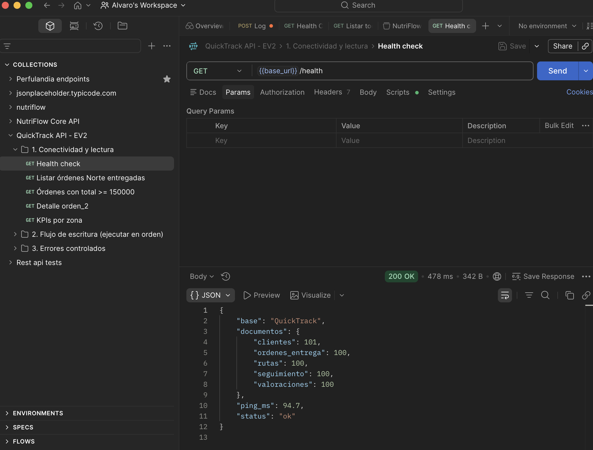
*Figura 14. Postman: `GET /health` (200 OK) con ping a Atlas y conteo de documentos.*

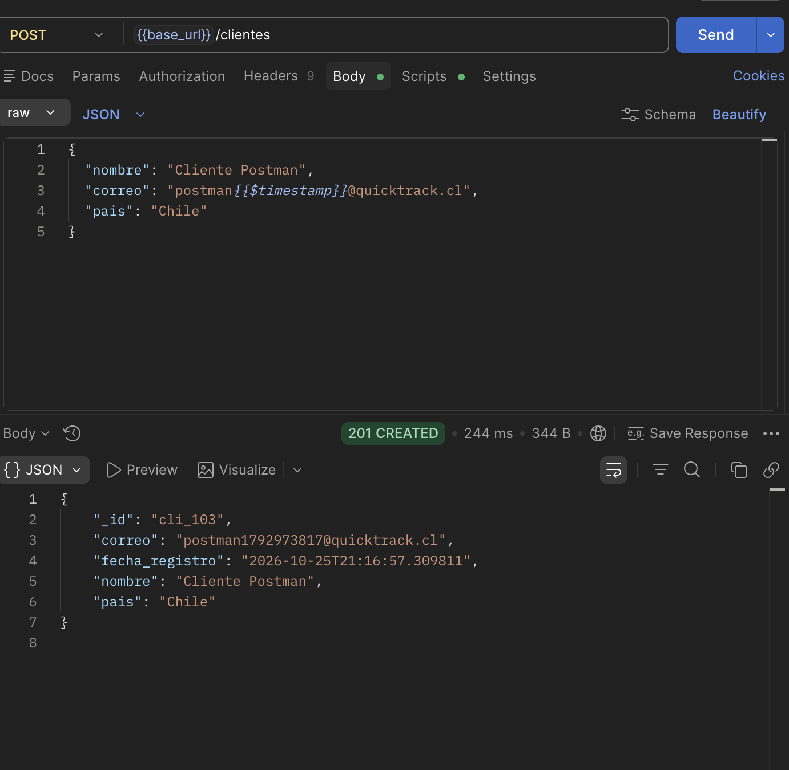
*Figura 15. Postman: `POST /clientes` (201 Created).*

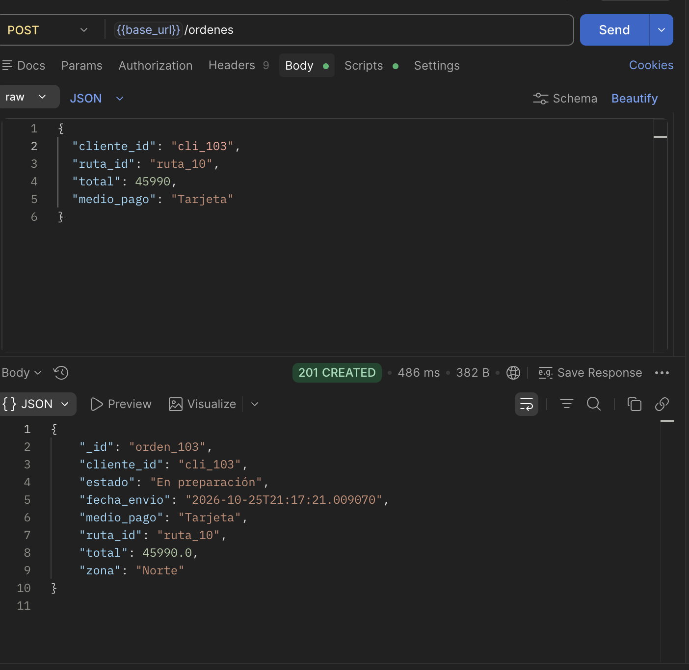
*Figura 16. Postman: `POST /ordenes` (201 Created). La API agrega la zona desde la ruta y el estado inicial.*

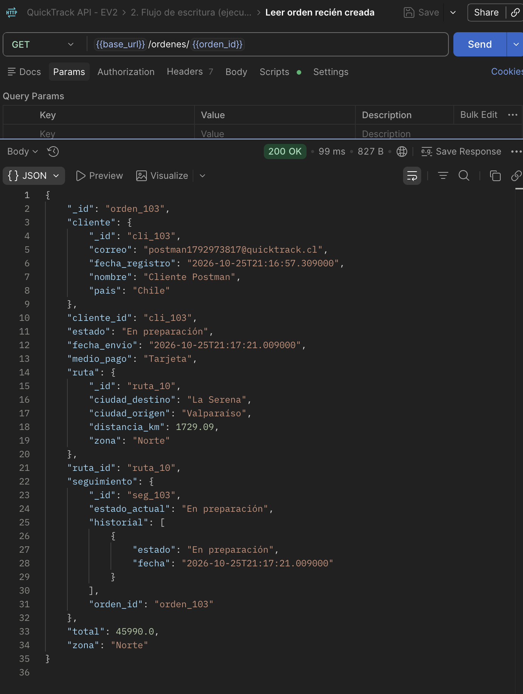
*Figura 17. Postman: `GET /ordenes/{id}` justo después de crearla. Devuelve cliente, ruta y seguimiento (lectura en tiempo real).*

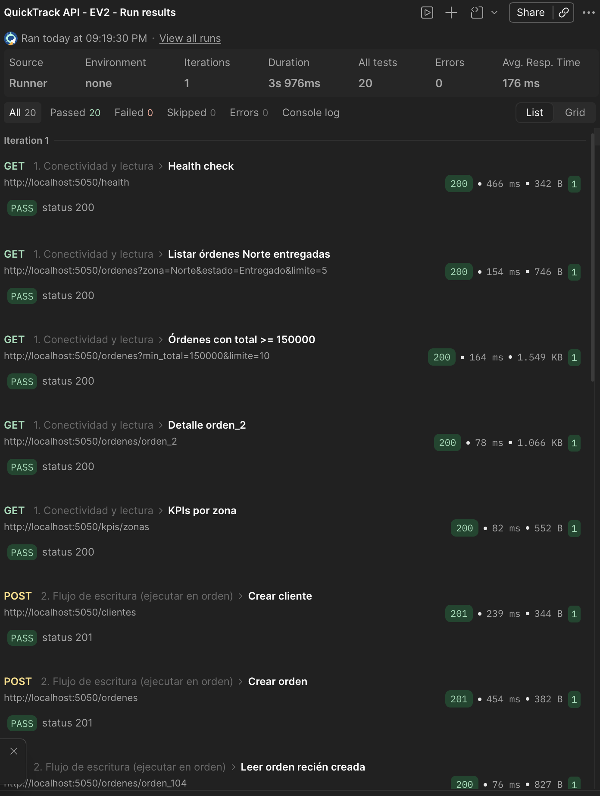
*Figura 18. Postman Runner: 20 de 20 tests aprobados, 0 errores (parte 1).*

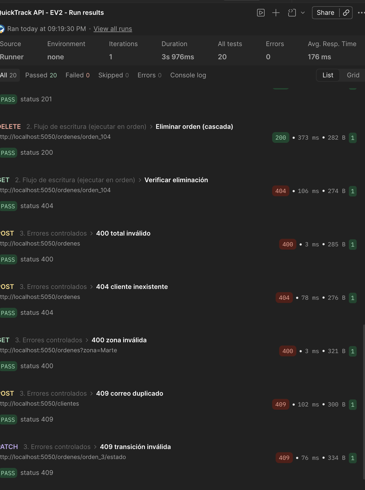
*Figura 19. Postman Runner: Delete en cascada, verificación con 404 y errores controlados (parte 2).*

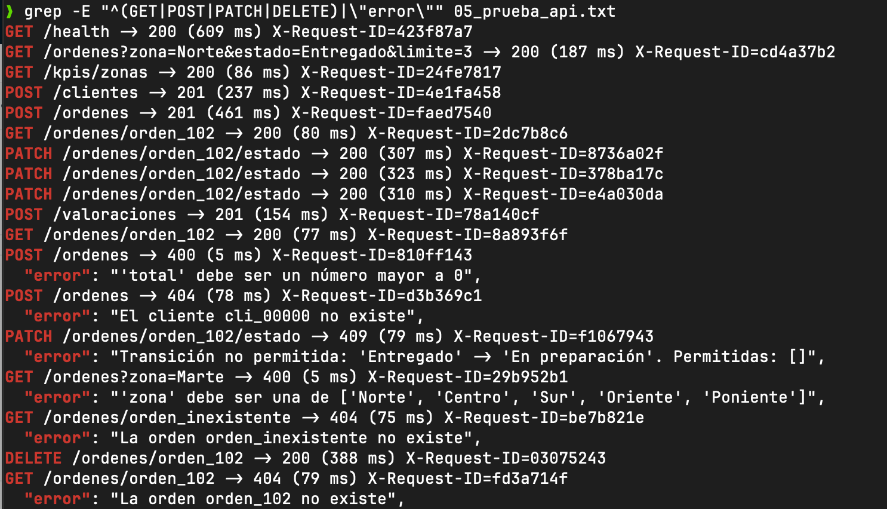
*Figura 20. Prueba end-to-end de la API con `05_prueba_api.py`: 18 llamadas con su status y `X-Request-ID`.*

---

## 7. Control de errores y validaciones

| Mecanismo | Implementación |
|---|---|
| Validación de entradas | `servicio.py` revisa tipos, rangos, enums, formato de correo y largo de los textos antes de tocar la base |
| Validación en la base | `$jsonSchema` estricto e índices únicos (segunda línea de defensa) |
| Integridad referencial | Verifica que el cliente, la ruta y la orden existan antes de escribir |
| Atomicidad | Transacciones (`with_transaction`) en las escrituras que afectan varias colecciones |
| Concurrencia | Control optimista en el cambio de estado (el filtro incluye el estado leído) |
| Códigos HTTP | 400 validación · 404 no existe · 409 conflicto o duplicado · 500 error de base · 503 sin conexión; siempre en JSON con `request_id` |
| **Trazabilidad** | Cada request recibe un `X-Request-ID` (header de respuesta). `logs/quicktrack.log` registra fecha, nivel, módulo, request ID, método, ruta, status y duración; las advertencias y errores quedan con su causa. |
| Pruebas de conectividad | `ping` al iniciar (con latencia), `serverSelectionTimeoutMS`, endpoint `/health` |
| Secretos | Credenciales en `.env`, excluido por `.gitignore` |

Extracto de `logs/quicktrack.log`:
```
2026-10-25 20:54:51 | INFO    | api | [03075243] DELETE /ordenes/orden_102 -> 200 (382.7 ms)
2026-10-25 20:54:51 | WARNING | api | [fd3a714f] NoEncontrado: La orden orden_102 no existe
2026-10-25 20:54:51 | INFO    | api | [fd3a714f] GET /ordenes/orden_102 -> 404 (73.6 ms)
```

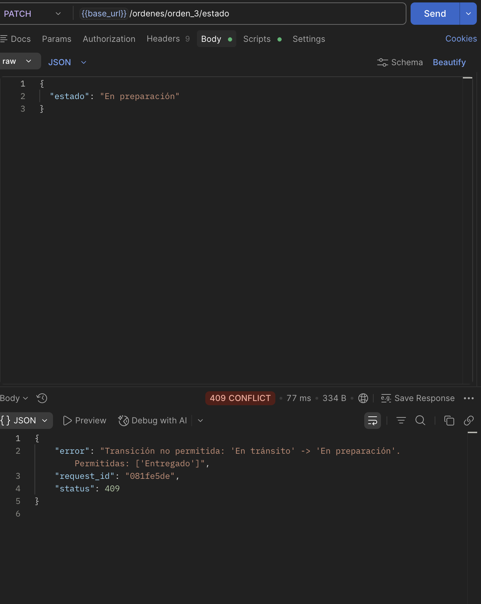
*Figura 21. Postman: transición de estado inválida rechazada con 409 Conflict y `request_id`.*

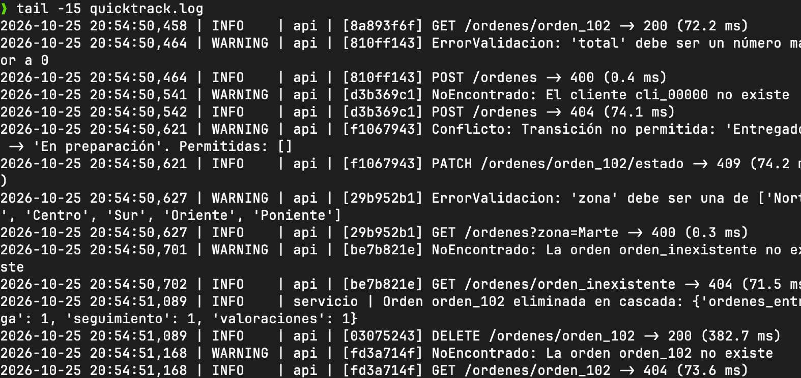
*Figura 22. Log de trazabilidad: cada request con su ID, método, ruta, status y duración; las advertencias muestran la causa.*

---

## 8. Visualización en Power BI

**Flujo:** MongoDB Atlas → `06_exportar_powerbi.py` → `powerbi/quicktrack_powerbi.xlsx` → Power BI

1. El script usa `pymongo` y ejecuta una agregación que une las 5 colecciones con `$lookup`. El resultado es una **tabla de hechos** con una fila por orden: cliente, ruta, zona, estado, medio de pago, total, puntaje, recomendación, retraso y días de entrega.
2. Con `pandas` calcula tablas resumen (`kpi_zona`, `medio_pago`, `comentarios`) y exporta todo a Excel.
3. Excluye los registros de prueba creados por la API y Postman, para que no alteren los indicadores.
4. En Power BI se importa el Excel y se arma un dashboard con filtros por zona, medio de pago y año.

**Indicadores del dashboard**

| Visual | Indicador | Lectura |
|---|---|---|
| Tarjetas | Total de órdenes, ventas, % cancelación, puntaje promedio, % que recomienda | Resumen general de la operación |
| Barras | % de cancelación por zona | **Centro (47,1 %)** y **Norte (36,4 %)** son las zonas críticas |
| Barras | Puntaje promedio por zona | Centro tiene la peor satisfacción (2,71); Oriente, la mejor (3,35) |
| Columnas | % que recomienda por medio de pago | Transferencia 50 %, Tarjeta 47,1 %, Efectivo 38,2 % |
| Anillo | Órdenes por estado | Distribución del estado operativo |
| Líneas | Ventas por mes | Evolución temporal de los envíos |

> [CAPTURA POWER BI: dashboard completo]

**Recomendaciones para la gerencia**
- **Centro:** revisar las causas de cancelación. Es la zona con más cancelaciones y peor puntaje, y sus rutas son las más largas (1.552 km en promedio).
- **Oriente:** tiene el mayor % de comentarios de retraso (19,2 %), aunque su satisfacción general es alta. Conviene revisar los tiempos de despacho.
- **Efectivo:** es el medio de pago con menor recomendación. Se podría incentivar el pago digital.

---

## 9. Conclusiones

- El modelo documental se ajusta bien al caso: cada orden y su historial de seguimiento quedan como documentos autocontenidos, y las agregaciones permiten calcular los KPI directamente en la base.
- Al revisar los datos del anexo se encontraron problemas reales de calidad: identificadores incompatibles, fechas como texto, 72 seguimientos inconsistentes con su historial y 81 órdenes con un estado distinto al de su seguimiento. Todos se detectaron y corrigieron con scripts reproducibles.
- La combinación de validación en la aplicación, `$jsonSchema`, índices únicos y transacciones evita duplicados, documentos huérfanos y datos inválidos.
- **Indicadores propuestos para el seguimiento operativo:**
  - % de cancelación por zona (alerta si supera 30 %)
  - % de valoraciones con retraso
  - Puntaje promedio y % que recomienda
  - Días promedio de entrega por zona
  - Ventas por zona

  Todos se pueden obtener desde `/kpis/zonas` o desde los CSV para Power BI.
